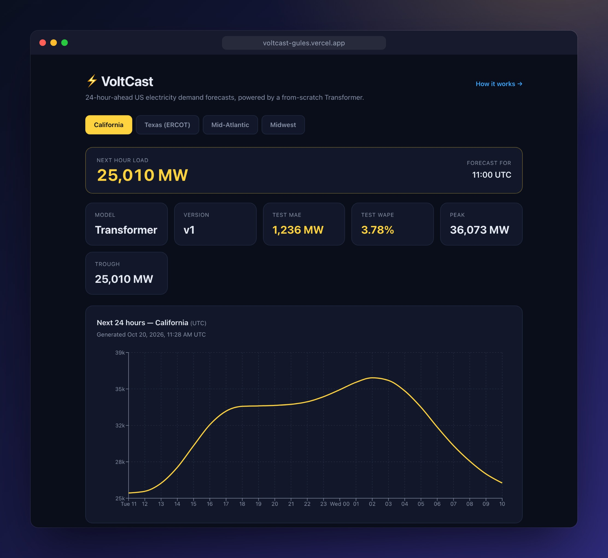
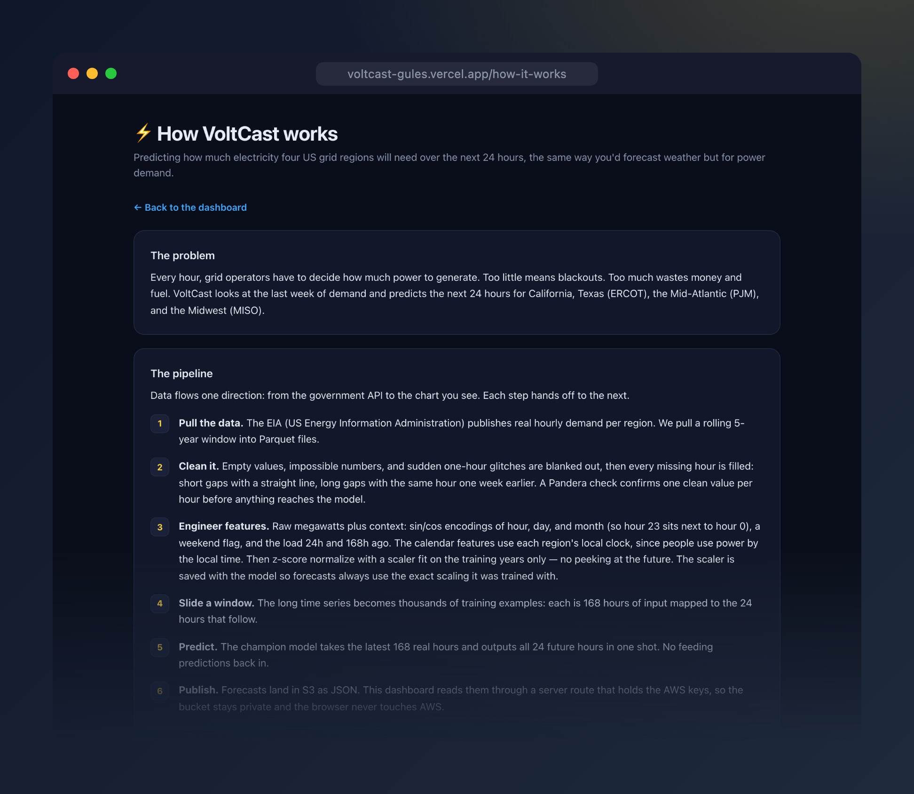
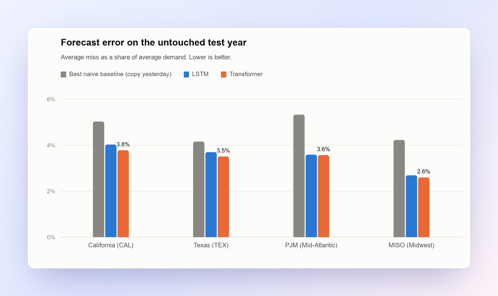
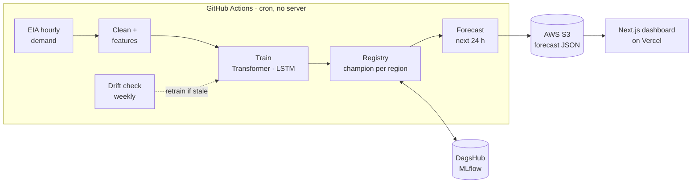

<div align="center">

# ⚡ VoltCast

**24-hour electricity demand forecasts for four US power grids — trained, tracked and served with no server.**

<a href="https://github.com/glenlouis8/voltcast/actions/workflows/forecast.yml"></a>      

[**Live dashboard**](https://voltcast-gules.vercel.app) · [How it works](https://voltcast-gules.vercel.app/how-it-works) · [Results](#results) · [Architecture](#architecture) · [Run it](#running-locally)



<br>

<table>
<tr>
<td align="center" width="25%"><b>4</b><br><sub>US grid regions</sub></td>
<td align="center" width="25%"><b>24 h</b><br><sub>ahead, one shot</sub></td>
<td align="center" width="25%"><b>2.7 – 3.8%</b><br><sub>error on a year the models never saw</sub></td>
<td align="center" width="25%"><b>$0</b><br><sub>to run, no always-on server</sub></td>
</tr>
</table>

</div>

---

## What it does

Grid operators must match supply to demand every hour. Too little means blackouts, too much wastes money. VoltCast looks at the last week of real demand (168 hours) and predicts the next 24 hours for **California**, **Texas (ERCOT)**, **PJM (Mid-Atlantic)** and **MISO (Midwest)**.

It is the whole production loop, not just a model: **ingest → clean → train → evaluate → register → forecast → monitor → retrain**. Scheduled GitHub Actions do the work, models live in a hosted registry, forecasts in object storage, and the dashboard reads them directly. Every layer is written explicitly (no `Trainer`, no AutoML) so the engineering is visible.

<table>
<tr>
<td width="52%" valign="top">

**Built to be trusted, not just to score well**

- **Honest evaluation.** 5 years split by time into 3 years train, 1 year validation, 1 year test. The test year is never used to make a decision.
- **Beats simple baselines everywhere.** Compared against "copy yesterday" and "copy last week" in every region.
- **Fair model selection.** The champion is picked on the validation year and re-scored on fresh data before it can be replaced.
- **Watches itself.** A weekly check replays the champion's last 60 days of forecasts and retrains it when it stops beating "copy yesterday".
- **Light daily run.** Each model carries its own scaler, so the daily forecast downloads 3 weeks of data, not 5 years.

</td>
<td width="48%" valign="top">



</td>
</tr>
</table>

---

## Results

Scored on the **untouched test year** (the most recent 12 months, Oct 2025 – Oct 2026), never seen during training or model selection. The champion in each region is picked on a separate validation year, not on the test year. Metric is **MAE in megawatts**, the average size of the forecast's miss per predicted hour, also shown as a share of average demand.

<div align="center">

</div>

| Region | Copy yesterday | Copy last week | LSTM | Transformer | Champion |
|--------|---------------:|---------------:|-----:|------------:|:--------:|
| California (CAL) | 1,642 MW (5.0%) | 2,696 MW (8.3%) | 1,316 MW (4.0%) | **1,236 MW (3.8%)** | Transformer |
| Texas (TEX) | 2,419 MW (4.2%) | 4,446 MW (7.6%) | 2,153 MW (3.7%) | **2,041 MW (3.5%)** | Transformer |
| PJM | 5,295 MW (5.3%) | 9,087 MW (9.1%) | 3,570 MW (3.6%) | **3,551 MW (3.6%)** | LSTM |
| MISO | 3,290 MW (4.2%) | 5,832 MW (7.5%) | 2,088 MW (2.7%) | **2,021 MW (2.6%)** | LSTM |

- Both neural models beat both naive baselines in every region. The champions beat the best baseline by **16% (TEX) to 37% (MISO)**.
- **Transformer vs LSTM is close.** The Transformer is ahead on the test year everywhere, but by 0.5%–6%, and in PJM it is a tie. In PJM and MISO the registry picked the LSTM because it scored better on the validation year. That is by design: the champion is chosen on validation so the test year stays an honest exam.
- Numbers are a snapshot from one training run. Exact figures move when the data window moves.

---

## Architecture



**Storage split — each tool does one job:**

| Thing | Home | Why |
|-------|------|-----|
| Code | GitHub | version control + CI |
| Models, scalers, champion alias | DagsHub (hosted MLflow) | versioning, registry, promotion |
| Forecasts | AWS S3 (parquet + JSON) | cheap files; CI writes, the dashboard reads |
| Raw data | nowhere, re-pulled from EIA each run | always fresh, rolling 5-year window |

The S3 bucket is private. The dashboard reads it through a server route that holds the AWS keys, so they never reach the browser.

### Automation

| Workflow | Schedule | Command | Purpose |
|----------|----------|---------|---------|
| `forecast.yml` | daily (`13 6 * * *`) | `pipeline.py forecast` | 24h forecast for all regions → S3 |
| `retrain.yml` | weekly (`0 2 * * 0`), one job per region | `pipeline.py retrain --region <r>` | drift/age check → retrain the Transformer if needed |
| `build.yml` | manual, one job per region | `pipeline.py build --region <r>` | full rebuild: train both models, crown champion, first forecast |

All run on free public-repo runners (CPU; the models are small). Cost ≈ **$0**.

---

## The models

Two networks with identical input and output, so the comparison is fair.

**TemporalTransformer** (`src/model.py`):

```
Input  (batch, 168 hours, 10 features)
  → Linear projection           10 → d_model=64
  → Positional encoding         (sin/cos, so order is known)
  → TransformerEncoder × 2      nhead=4, dim_feedforward=256, dropout=0.1
  → take last timestep
  → Linear output head          64 → 24
Output (batch, 24)              next 24 hours of MW
```

**LSTMBaseline**: 2 layers, `hidden_dim=128`, last hidden state → linear head → 24.

It is a **168 → 24 sequence-to-sequence** problem solved in **one shot**: the model sees 168 real hours (one week) and outputs all 24 future hours at once. No recursive feeding of predictions back as inputs, which compounds error.

Two naive baselines run alongside for the comparison: **copy yesterday** (the next 24 hours repeat the last 24) and **copy last week** (the same hours one week ago).

### Features (10)

- **Load** (`load_mw`), z-score scaled
- **Fourier time encodings**: sin/cos of hour, day-of-week and month (so hour 23 and hour 0 are "close"), computed in each region's **local time**, since people use power by the local clock
- **Weekend flag**, also in local time
- **Lags**: load 24h and 168h (same hour last week) ago

The scaler is fit on the **training years only** (no leakage) and is **saved with each registered model**, so a forecast always uses exactly the scaling that model was trained with.

---

## MLOps highlights

- **From-scratch models.** Every network is written in plain PyTorch, with a raw training loop (AdamW, `CosineAnnealingLR`, gradient clipping, early stopping). No HuggingFace, no `Trainer`.
- **Data cleaning and validation.** `validation.py` blanks out impossible values and sudden one-hour glitches, then fills every missing hour (short gaps with a straight line, long gaps with the same hour one week earlier). A Pandera contract confirms one clean value per hour before anything reaches training.
- **Chronological splits.** 5 years split by time, never shuffled: 3 years train, 1 year validation, 1 year test. Each part covers every season. The test year is never used to make a decision.
- **Champion / challenger registry.** `registry.py` picks the better model on the **validation year**, registers it in DagsHub with its scaler, and promotes it only if it beats the current champion by **>1%**. The champion is re-scored on the same new data first, so the comparison is fair.
- **Performance-based drift detection.** `drift.py` replays the champion's last 60 days of forecasts against what actually happened. Because some seasons are simply harder for every forecaster, it judges the champion *relative to "copy yesterday"* and compares that ratio with the one from the test year. Exit code 10 means drift; any other failure is an error, not a signal.
- **Hybrid retraining.** `pipeline.py retrain` retrains a region when drift fires **or** the champion is older than 30 days.
- **Light daily forecast.** The daily job downloads only the last three weeks of data. No retraining, no 5-year pull.

---

## Known limitations

- **No weather input.** Demand is driven heavily by temperature, but the models only see past demand and the calendar. A temperature forecast would likely help most; it is deliberately left out to keep the system simple, and is untested here.
- **Demand level is rising.** The test year averages higher than the training years, so the models slightly under-predict. The weekly drift check and 30-day retrain are meant to track this.
- **The newest hours are preliminary.** EIA revises its most recent 1–3 hours after publishing them (changes of up to ~2,500 MW were observed), so the last few input hours of a forecast can shift slightly between runs.
- **One test year.** Every season is covered once, so regional error rates are estimates from a single year.
- **LSTM trains on CPU only.** Apple's GPU backend (MPS) gave wrong LSTM results in testing (weights that scored well on the GPU scored far worse on the CPU), so the LSTM is always trained on the CPU. The Transformer was checked and is identical on both.
- **The weekly retrain only retrains the Transformer.** In regions where the LSTM is champion (PJM, MISO), a retrained Transformer must beat the LSTM by >1% on validation to take over.

---

## Running locally

Dependencies are managed with [uv](https://github.com/astral-sh/uv).

```bash
uv sync                                   # install everything from uv.lock

# one command per pipeline mode:
uv run python src/pipeline.py build       # full rebuild (trains all models, slow)
uv run python src/pipeline.py forecast    # daily 24h forecast for all regions
uv run python src/pipeline.py retrain     # drift/age-gated retrain
```

<details>
<summary><b>Run individual stages</b></summary>

```bash
# regions: CAL, TEX, PJM, MISO
uv run python src/ingestion.py
uv run python src/validation.py
uv run python src/features.py
uv run python src/train.py --model transformer --region CAL
uv run python src/train.py --model lstm --region CAL
uv run python src/registry.py --region CAL
uv run python src/evaluate.py --region CAL
uv run python src/inference.py --region CAL
uv run python src/drift.py --region CAL
```

</details>

<details>
<summary><b>Run the dashboard</b></summary>

The dashboard is a Next.js app in `frontend/`, deployed on Vercel. It fetches forecasts through a server route (`/api/forecast/<region>`) that reads the private S3 bucket with server-side AWS credentials.

```bash
cd frontend
npm install
npm run dev    # http://localhost:3000 (needs AWS creds in frontend/.env.local)
```

</details>

<details>
<summary><b>Configuration (<code>.env</code>)</b></summary>

```bash
EIA_API_KEY=...               # free key from eia.gov/opendata
DAGSHUB_REPO_OWNER=...         # hosted MLflow (models + registry)
DAGSHUB_REPO_NAME=...
DAGSHUB_TOKEN=...
S3_BUCKET=...                  # forecasts
AWS_ACCESS_KEY_ID=...
AWS_SECRET_ACCESS_KEY=...
AWS_DEFAULT_REGION=us-east-1
```

Everything has a **local fallback**: with no cloud config, MLflow uses local SQLite and storage writes to `data/`. The same code runs offline or in CI.

</details>

<details>
<summary><b>Project structure</b></summary>

```
voltcast/
├── src/
│   ├── ingestion.py    # pull hourly demand from EIA (last N days, default 5 years)
│   ├── validation.py   # clean glitches/gaps + Pandera contract
│   ├── features.py     # local-time calendar features, lags, z-score scaling
│   ├── dataset.py      # time split + sliding windows (168→24), DataLoaders
│   ├── model.py        # TemporalTransformer + LSTMBaseline
│   ├── train.py        # hand-written training loop + MLflow logging
│   ├── evaluate.py     # test-year comparison: baselines vs LSTM vs Transformer
│   ├── registry.py     # champion/challenger promotion, saves scaler with the model
│   ├── inference.py    # champion → next 24h forecast
│   ├── drift.py        # is the champion still beating "copy yesterday"?
│   ├── storage.py      # S3-or-local I/O (parquet + JSON)
│   ├── mlflow_setup.py # DagsHub-or-local MLflow config
│   └── pipeline.py     # orchestrator: build / forecast / retrain
├── frontend/           # Next.js dashboard (Vercel); reads private S3 via a server route
├── .github/workflows/  # forecast · retrain · build
└── pyproject.toml      # deps (managed with uv)
```

</details>

---

## Design rules

1. PyTorch from scratch: no HuggingFace, no `Trainer`.
2. One-shot forecasting: 168 real hours in, 24 out. No recursive feeding.
3. Never use the test year to make decisions during training, tuning or model selection.
4. Never shuffle a time series: splits are chronological.
5. Fit scalers on training data only: no leakage.

<div align="center">
<sub>Built with PyTorch · MLflow / DagsHub · Pandera · AWS S3 · GitHub Actions · Next.js / Vercel · uv · EIA Open Data</sub>
</div>
